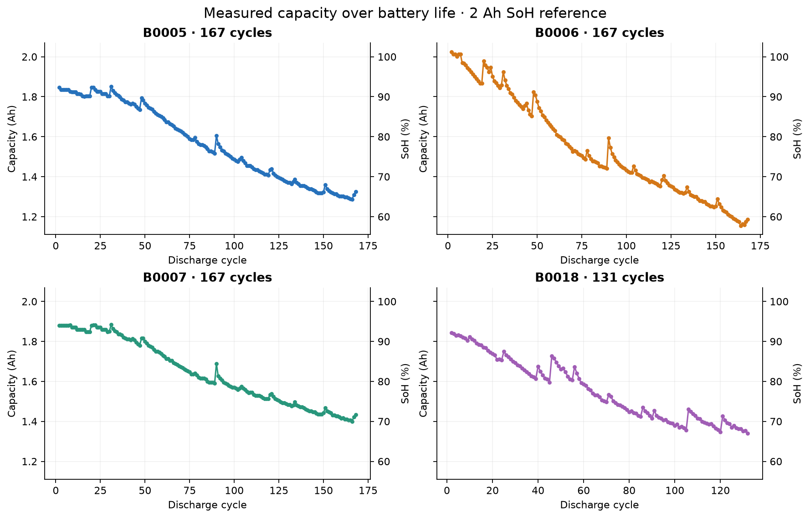
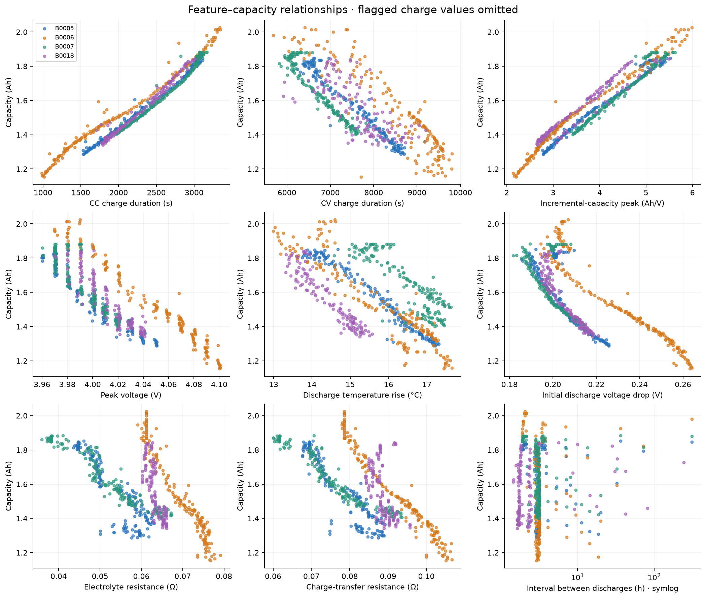
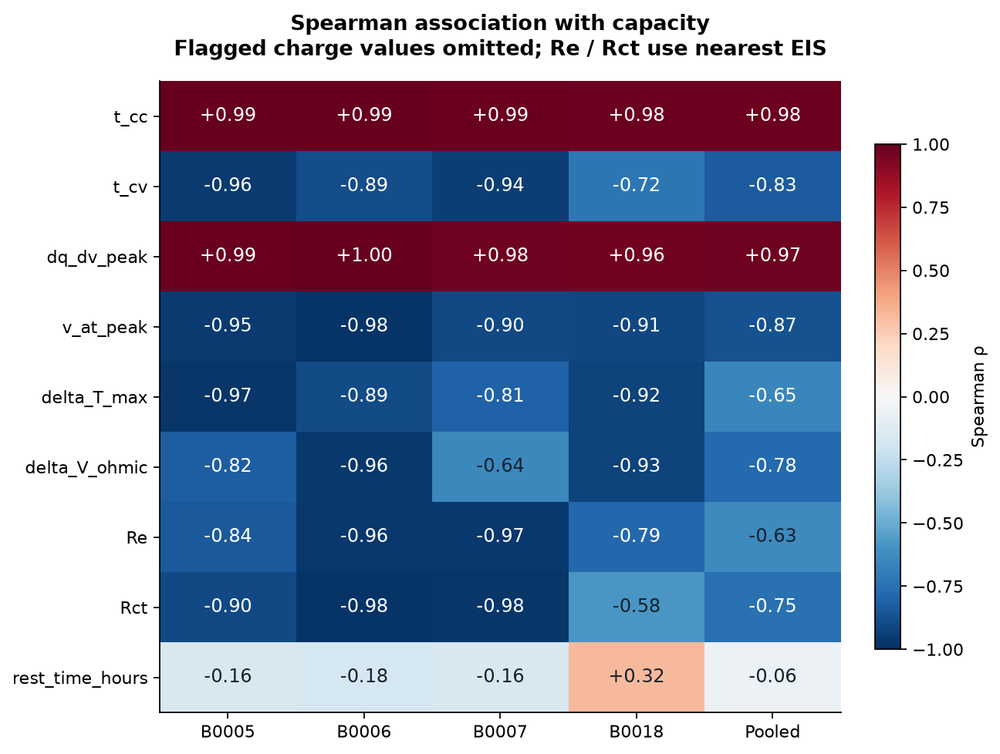
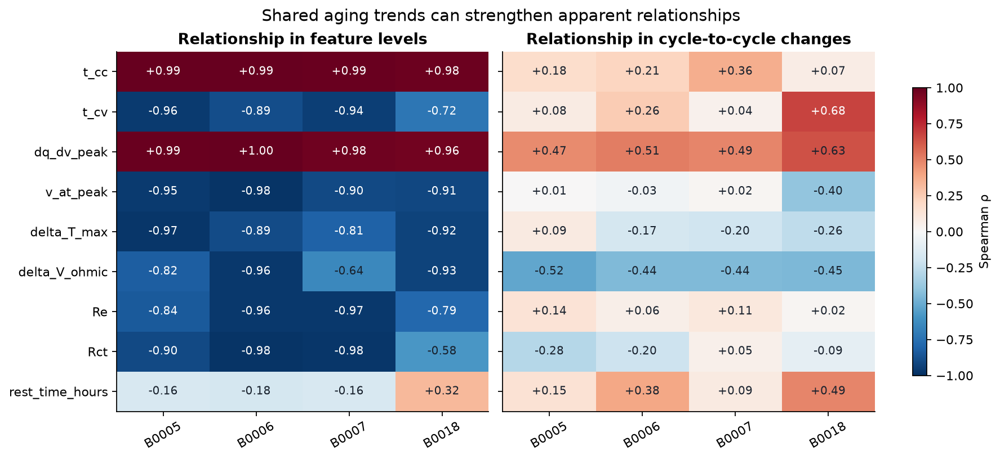

# Early battery data analysis

Source commit: `043ec72936025ce59a3753b31c3c3a16e531df5a`. All four batteries are exploratory; there is no untouched test set in this analysis.

No predictive models were trained. Each row is one aligned discharge cycle. The raw files contain 636 discharges; the source loader excludes the first discharge of each battery, leaving 632 aligned cycles. This analysis preserves those 632 rows. The label is measured capacity in Ah. SoH = capacity / 2 Ah × 100, so Pearson and Spearman correlations are identical for either label.

## Main findings

1. **Charging duration and incremental-capacity peak are the clearest candidates for further validation.** Per-battery Spearman ρ: t_cc +0.978 to +0.995; dq_dv_peak +0.965 to +0.995. The peak's capacity association remains strong with 5, 10 and 20 mV bins. This does not establish generalization to new cells or other operating conditions.

2. **The two leading charge features are redundant.** Their within-battery Spearman association is +0.932 to +0.996. Later validation should compare each alone and together rather than assume both add independent information.

3. **Aging trends account for part of the apparent association.** Correlation of consecutive changes falls to +0.075–+0.361 for t_cc and +0.475–+0.633 for dq_dv_peak. Rank residualization on cycle retains positive associations for both. These are different descriptive diagnostics, not proof of a mechanism.

4. **CV duration and peak position associate negatively with capacity.** Per-battery ρ: t_cv -0.957 to -0.724; v_at_peak -0.983 to -0.899. This is an observed direction; coefficients should not be forced to an assumed sign.

5. **The current interval feature is inconsistent.** rest_time_hours has per-battery ρ -0.176 to +0.321. It includes charging time. This result cannot establish that actual idle rest has no relationship to capacity recovery.

6. **Five charge cycles require flags, not hidden repairs.** The source pipeline fills t_cc, t_cv and dq_dv_peak in 5 cycles: B0005/6/7 cycle 31; B0018 cycles 46 and 56. The sequential cleaning loop leaves the fallback v_at_peak = 4 V unchanged in those cycles. Primary plots omit all four affected charge measurements and retain the capacity labels.

7. **Impedance alignment uses future information.** Of 632 rows, 175 (27.7%) select an EIS start after discharge starts, and 599 (94.8%) select an EIS start after charging ends. A prior-start alternative is exported with missing values preserved. Impedance completion times still need verification.

8. **Discharge temperature and voltage-drop associations are strong but timing-dependent.** They cannot be inputs for an end-of-charge prediction. The temperature feature requires the complete discharge; the voltage drop requires the initial load step.

**Before training:** validate t_cc and dq_dv_peak against raw waveforms, repair the quality flags and prediction-time alignment, define actual idle rest, and establish new validation data. Keep the current findings exploratory.

## Dataset coverage

| Battery | Cycles | Capacity range (Ah) | SoH range (%) | Flagged charge cycles | Nearest EIS starts after discharge |
|---|---:|---:|---:|---:|---:|
| B0005 | 167 | 1.287–1.852 | 64.4–92.6 | 1 | 33 |
| B0006 | 167 | 1.154–2.025 | 57.7–101.3 | 1 | 33 |
| B0007 | 167 | 1.400–1.883 | 70.0–94.2 | 1 | 33 |
| B0018 | 131 | 1.341–1.843 | 67.1–92.2 | 2 | 76 |

## Feature–label relationships

Spearman correlations below use re-extracted features with flagged charge values omitted, without interpolation. EIS correlations here reproduce nearest-sweep alignment and are descriptive only: some measurements start in the future. Use `prior_impedance` in the CSV for a timing-aware alternative. The interval feature includes charging time.

| Feature | B0005 | B0006 | B0007 | B0018 | Pooled |
|---|---:|---:|---:|---:|---:|
| t_cc | +0.993 | +0.995 | +0.991 | +0.978 | +0.979 |
| t_cv | -0.957 | -0.890 | -0.940 | -0.724 | -0.831 |
| dq_dv_peak | +0.985 | +0.995 | +0.976 | +0.965 | +0.970 |
| v_at_peak | -0.954 | -0.983 | -0.899 | -0.908 | -0.869 |
| delta_T_max | -0.972 | -0.894 | -0.809 | -0.925 | -0.651 |
| delta_V_ohmic | -0.824 | -0.965 | -0.641 | -0.930 | -0.776 |
| Re | -0.842 | -0.963 | -0.967 | -0.788 | -0.633 |
| Rct | -0.899 | -0.979 | -0.976 | -0.581 | -0.750 |
| rest_time_hours | -0.157 | -0.176 | -0.159 | +0.321 | -0.056 |

Positive values mean higher feature values accompany higher capacity. Negative values mean they accompany lower capacity. Neither proves causation or out-of-battery predictive value.

## Audit and limitations

- Source CSV and re-extracted values are retained separately. The primary observed version masks all four charge features when original t_cc < 100 s or original dq_dv_peak < 0.1 Ah/V. These are the repository's screening thresholds, used as flags rather than proven error labels. No rows or target labels are deleted, no imputation is applied, and pair counts are exported.
- The operation audit found 6 non-finite sensor values in one extra B0018 charging operation (operation_id 114, zero-based). That charge is followed by another charge and is not selected for any aligned cycle. Selected charge/discharge records have finite sensor values, matching array lengths, and increasing sample times. No raw values were repaired.
- The repository's cleaning loop recomputes its invalid mask after each column. This can leave v_at_peak unchanged after an earlier dq_dv_peak replacement clears the condition. `csv_reconstruction_checks.csv` records exact reproduction of the sequential loop; `feature_changes.csv` records all changed feature cells relative to raw extraction.
- All available batteries were inspected. Their labels must not subsequently be presented as an untouched test set after selecting features from this report. Obtain an external holdout, or report development results honestly and use nested group evaluation for further selection.
- Cycles from one battery are temporally dependent. No naive independent-row p-values or confidence intervals are reported. Only four cells are available, and pooled results can obscure cell-specific behavior. Operating conditions are exported in the audit but no multivariable adjustment for temperature/current/protocol has been performed.
- B0006 reaches 101.26% SoH with the rated 2 Ah denominator. Values above 100% are retained: rated capacity is a reference and may be lower than an individual measured capacity. Do not automatically clip them.
- Full-discharge temperature rise is available after discharge. The voltage-drop feature becomes available after discharge load application. Both are unavailable for an end-of-charge prediction. Capacity itself is a label and must not be used as a predictor of SoH.
- The nearest impedance sweep is chosen using the discharge start timestamp and can be in the future. Future-start counts are definite unavailability cases. Even a past start does not establish sweep completion: impedance end timestamps are unavailable here. The prior-start alternative is a diagnostic, not a certified online-ready feature.
- The feature called rest_time_hours includes intervening charge time. The post-charge gap exported by the audit can include other operations; it is not automatically pure idle rest either.
- Capacity integration is a diagnostic. The supplied label is compared with both full-record integration and integration to an interpolated 2.7 V crossing, when present. Endpoint and sampling conventions can cause differences; labels are not replaced.
- Cycle-adjusted rank correlation removes a linear relationship with cycle ranks only. It does not remove every aging trend or establish causation. Consecutive differences amplify noise and answer a different question from long-term feature levels.
- Peak extraction sorts by voltage after integrating in time. Small voltage reversals and the smoothing/bin-width choices can affect peaks. A 5/10/20 mV sensitivity comparison is exported, but electrochemical peak identity has not been validated.

## Files and method

- `correlations.csv`: Pearson and Spearman, valid pair counts, four data versions, per battery and pooled. Versions: repository_csv; raw_extracted; observed_flagged; prior_impedance (flagged charge values plus latest EIS starting by charge end).
- `cycles_observed_flagged.csv`: primary exploratory table; original CSV is in ../data/.
- `raw_cycle_audit.csv` and `operations.csv`: raw alignment timestamps, operating conditions, integration checks, extraction diagnostics, and alternate bin widths.
- `data_quality.csv`, `battery_summary.csv`, `feature_changes.csv`, and `csv_reconstruction_checks.csv`: quality, coverage, replacements and reproduction checks.
- `temporal_diagnostics.csv`: feature/capacity trends with cycle, rank residualization, and consecutive-change association.
- `feature_redundancy.csv`: pairwise feature correlations within each battery.
- `peak_bin_sensitivity.csv`: peak correlations with capacity and rank stability versus the 10 mV extraction.
- `figures/`: PNG and SVG plots, including separate scatter grids for every battery.

Reproduce with the pinned dependencies in ../Code/analysis/requirements.txt and `python Code/analysis/run_eda.py` from the project root. Missing raw files are downloaded from the pinned GitHub URLs and checked against SHA-256 hashes in ../Code/analysis/source_manifest.json.

References: [source repository](https://github.com/Marsel204/SoC_BatteryHealthAI/tree/043ec72936025ce59a3753b31c3c3a16e531df5a); [NASA field documentation](https://data.nasa.gov/dataset/li-ion-battery-aging-datasets); [Pearson](https://docs.scipy.org/doc/scipy/reference/generated/scipy.stats.pearsonr.html); [Spearman](https://docs.scipy.org/doc/scipy/reference/generated/scipy.stats.spearmanr.html).
